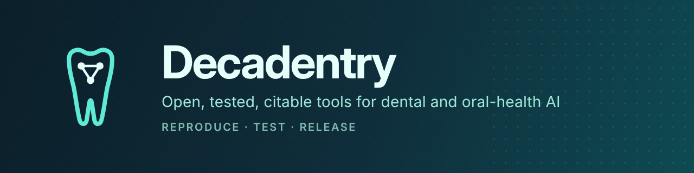

**Decadentry** turns published dental and oral-health AI research into open software that anyone can install, test and cite.
Each tool starts from a peer-reviewed paper, re-implements or extends its method on public data, and ships with tests,
continuous integration, an honest comparison with the original results, and a Zenodo DOI.

### Tools

<!-- TOOLS:START (updated automatically at each release) -->
| Tool | What it does | Source paper | DOI |
|---|---|---|---|
| [selectperio](https://github.com/Decadentry/selectperio) | Selective (abstaining) severe vs no periodontitis labelling from self-reported questions; open re-implementation with an external check on NHANES 2009-2014 | Stamatelou et al., Sci Rep 2026 ([doi](https://doi.org/10.1038/s41598-026-43934-6)) | [10.5281/zenodo.24569301](https://doi.org/10.5281/zenodo.24569301) |
| [dentagree](https://github.com/Decadentry/dentagree) | Observer-agreement analysis for dental imaging studies: kappa, Gwet AC1, Krippendorff alpha, ICC, cluster bootstrap, paired protocol comparison, design simulation, GRRAS reports | Rezai et al., Oral Surg Oral Med Oral Pathol Oral Radiol 2026 ([doi](https://doi.org/10.1016/j.oooo.2026.08.014)) | [10.5281/zenodo.24601789](https://doi.org/10.5281/zenodo.24601789) |
<!-- TOOLS:END -->

### How we build

- **Grounded in a paper.** Every repository cites the study it builds on and says plainly where it reproduces, extends or differs from it.
- **Tested.** Unit and integration tests run on every change (GitHub Actions); results are regenerated from scripts, not typed in.
- **Honest about limits.** Model cards, reporting checklists (TRIPOD+AI, CLAIM, STARD-AI where they apply) and a limitations section in every README.
- **Citable.** Each release is archived on Zenodo with a DOI; `CITATION.cff` in every repository.
- **Safe to share.** Public data only, no patient data; dataset licences respected (restricted data and weights are never redistributed).
- **Research and education use only.** None of these tools is a medical device or a substitute for clinical judgement.

### Feedback

Authors of the original papers, clinicians and researchers are warmly invited to open an issue or write to the founder.
Corrections are released as new versions with a changelog entry.

### Founder

Hossein Boustani Hezarani, DDS, dentist and applied AI researcher in oral health
[ORCID](https://orcid.org/0009-0007-8481-0498) · [Google Scholar](https://scholar.google.com/citations?user=Fk2mmg4AAAAJ) · [LinkedIn](https://www.linkedin.com/in/drhosseinboustani) · [ResearchGate](https://www.researchgate.net/profile/Hossein-Boustani-Hezarani) · [Personal projects](https://github.com/Hezarani)
